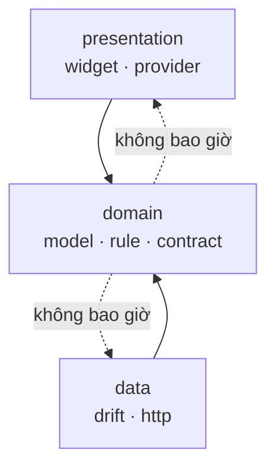
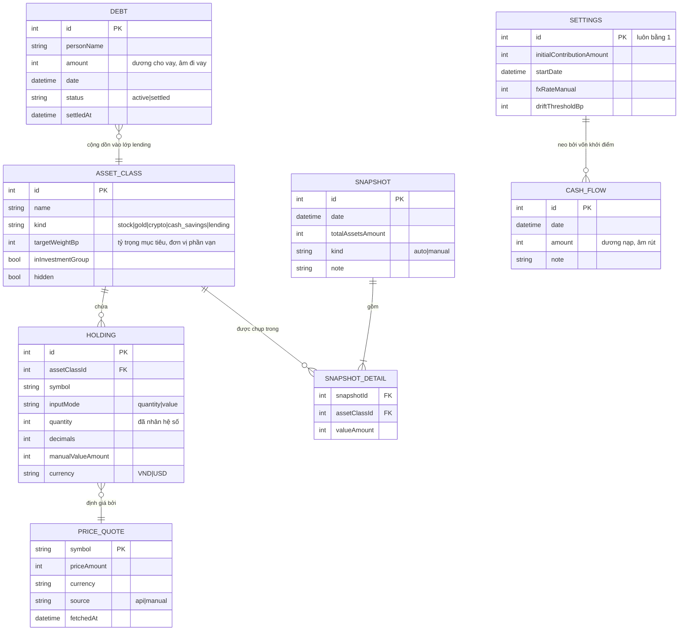
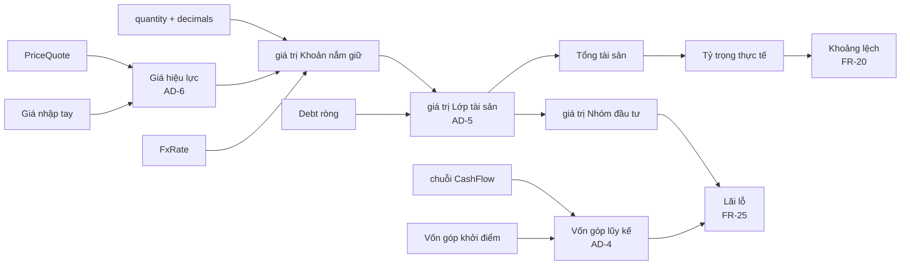

# Architecture Spine — App Quản lý Danh mục Đầu tư Cá nhân

## Mô hình thiết kế

**Clean Architecture rút gọn, chia theo tính năng.** Ba tầng, nhưng bỏ các lớp trung gian không mang lại giá trị ở quy mô này: không có lớp `UseCase` riêng cho mỗi hành động, không có `Entity` tách khỏi `Model` khi hai thứ trùng nhau.

| Tầng | Trách nhiệm | Được phép phụ thuộc vào |
|---|---|---|
| `presentation` | Widget, màn hình, provider của Riverpod | `domain` |
| `domain` | Model thuần Dart, quy tắc nghiệp vụ, hợp đồng repository | không phụ thuộc tầng nào |
| `data` | Cài đặt repository, bảng Drift, gọi mạng | `domain` |



Tầng `domain` không biết gì về Flutter, Drift hay HTTP. Đây là điều kiện để viết test cho toàn bộ công thức tài chính mà không cần dựng giả lập nào — mà công thức tài chính chính là thứ dễ sai nhất trong sản phẩm này.

## Bất biến và quy tắc

### AD-1 — Hướng phụ thuộc một chiều

- **Binds (ràng buộc):** toàn bộ mã nguồn
- **Prevents (ngăn chặn):** logic nghiệp vụ dính vào Flutter hoặc Drift, khiến không viết test được nếu không dựng cả một môi trường giả lập
- **Rule (quy tắc):** file trong `domain/` không được `import` bất cứ thứ gì từ `package:flutter`, `package:drift`, `package:http`, hay từ `data/` và `presentation/`. Tầng `data` và `presentation` phụ thuộc vào `domain` qua các lớp trừu tượng khai báo trong `domain/repositories/`.

### AD-2 — Riverpod 3.3.2, khai báo provider thủ công `[ĐÃ CHỐT]`

- **Binds (ràng buộc):** toàn bộ tầng `presentation`
- **Prevents (ngăn chặn):** nửa codebase dùng codegen, nửa viết tay; và việc nâng Riverpod lên 3.x làm vỡ toàn bộ tầng dữ liệu
- **Rule (quy tắc):** dùng `flutter_riverpod: ^3.3.2`. Không thêm `riverpod_generator`, `riverpod_annotation`, `riverpod_lint`, `custom_lint`. Provider khai báo bằng tay dưới dạng biến `final` cấp cao nhất trong `presentation/providers/`.

**Lý do ràng buộc này tồn tại:** `riverpod_generator` cần `analyzer ^9/^12` trong khi `drift_dev` cần `^10/^13` — loại trừ nhau dưới Dart 3.10.9. Bỏ codegen của Riverpod là cách duy nhất giữ được cả hai. Đường nâng cấp về sau tương đối gọn vì không có mã sinh tự động phải viết lại.

### AD-3 — Không có số thực dấu phẩy động trong bất kỳ phép tính tài chính nào

- **Binds (ràng buộc):** FR-9, FR-24, FR-25, và mọi phép tính phái sinh
- **Prevents (ngăn chặn):** sai số làm tròn tích lũy — kiểu lỗi không báo lỗi, chỉ lặng lẽ cho ra con số sai ở đúng chỗ người dùng nhìn nhiều nhất
- **Rule (quy tắc):** ba tầng biểu diễn tách bạch:
  - **Lưu trữ:** mọi giá trị tiền tệ là `int` đơn vị đồng. Mọi số lượng là `int` đã nhân hệ số, kèm cột `decimals` khai báo số chữ số thập phân của loại tài sản đó.
  - **Tính toán:** chuyển sang `Decimal` (gói `decimal`) trước khi nhân chia, chỉ quy về `int` ở bước cuối.
  - **Hiển thị:** làm tròn duy nhất một lần, tại lớp định dạng.

  Từ khóa `double` bị cấm xuất hiện trong `domain/` và trong mọi cột của bảng Drift. Ngoại lệ duy nhất: toạ độ vẽ biểu đồ trong `presentation/`.

### AD-4 — Vốn góp lũy kế là giá trị tính toán, không bao giờ lưu cứng

- **Binds (ràng buộc):** FR-22, FR-23, FR-24, FR-25
- **Prevents (ngăn chặn):** sửa một Dòng vốn quá khứ mà các giá trị lũy kế phía sau vẫn giữ số cũ — chính lỗi mà Excel tránh được nhờ công thức tự chạy lại, còn database thì không
- **Rule (quy tắc):** cơ sở dữ liệu chỉ lưu số tiền của từng Dòng vốn và một Vốn góp khởi điểm duy nhất trong bảng thiết lập. Không tồn tại cột `cumulative_contribution` ở bất kỳ bảng nào. Mọi truy vấn lũy kế tính bằng tổng chạy trên chuỗi Dòng vốn đã sắp theo ngày. Áp dụng cho cả việc đọc lại Bản chốt cũ.

### AD-5 — Giá trị tổng hợp luôn được suy ra, không bao giờ nhập tay

- **Binds (ràng buộc):** FR-8, FR-35
- **Prevents (ngăn chặn):** đúng lỗi đang có trong Excel — dòng `C VAY + CASH = 183` cộng thủ công từ hai sheet, sai ngay khi một bên đổi mà bên kia quên
- **Rule (quy tắc):** không tồn tại cột lưu tổng giá trị của một Lớp tài sản. Giá trị Lớp tài sản = tổng giá trị các Khoản nắm giữ thuộc nó; riêng lớp `lending` = tổng ròng các Khoản nợ đang hiệu lực. Tổng tài sản = tổng các Lớp tài sản không bị ẩn. Không có màn hình hay API nội bộ nào cho phép ghi trực tiếp các con số này.

### AD-6 — Giá hiệu lực có thứ tự ưu tiên cố định

- **Binds (ràng buộc):** FR-10, FR-12, FR-13, FR-14
- **Prevents (ngăn chặn):** hai chỗ trong mã nguồn tự quyết định lấy giá nào, cho ra hai con số khác nhau trên hai màn hình
- **Rule (quy tắc):** chỉ một hàm duy nhất trong `domain` được phép quyết định Giá hiệu lực, theo đúng thứ tự: Giá nhập tay nếu tồn tại, ngược lại Giá thị trường lưu gần nhất, ngược lại `null`. Khi trả về `null`, tầng hiển thị phải hiện trạng thái "chưa có giá" — tuyệt đối không thay bằng số 0. Mọi giá trả về đều kèm nguồn và thời điểm.

### AD-7 — Không có tác vụ nền

- **Binds (ràng buộc):** FR-28
- **Prevents (ngăn chặn):** kéo theo `WorkManager` và `BGTaskScheduler`, xin quyền chạy nền, và toàn bộ lớp phức tạp đi kèm
- **Rule (quy tắc):** Bản chốt tự động được sinh trong luồng khởi động ứng dụng, khi phát hiện chưa có Bản chốt cho ngày hôm nay. Ngày người dùng không mở ứng dụng thì không có Bản chốt, và **không nội suy**. Không đăng ký bất kỳ tác vụ nền nào ở cả hai nền tảng.

### AD-8 — Mạng chỉ được dùng để hỏi giá

- **Binds (ràng buộc):** FR-10, FR-11, và nguyên tắc riêng tư
- **Prevents (ngăn chặn):** một tính năng tương lai lặng lẽ gửi dữ liệu người dùng ra ngoài
- **Rule (quy tắc):** toàn bộ lời gọi mạng nằm trong đúng một thư mục `data/remote/`. Nội dung gửi đi chỉ được chứa ký hiệu tài sản và mã tiền tệ. Cấm gửi số lượng nắm giữ, giá trị, hay bất kỳ định danh người dùng nào. Không tích hợp công cụ phân tích hành vi, không thu thập số liệu sử dụng, không quảng cáo.

### AD-9 — Một Danh mục duy nhất, vĩnh viễn

- **Binds (ràng buộc):** toàn bộ mô hình dữ liệu
- **Prevents (ngăn chặn):** thêm khóa ngoại `portfolio_id` vào mọi bảng để phòng một tương lai đã được xác nhận là không bao giờ đến
- **Rule (quy tắc):** không bảng nào có cột `portfolio_id`. Thiết lập toàn cục nằm trong một bảng một dòng duy nhất.

### AD-10 — Mọi thay đổi cấu trúc dữ liệu phải có đường chuyển đổi

- **Binds (ràng buộc):** độ tin cậy
- **Prevents (ngăn chặn):** người dùng cập nhật ứng dụng rồi mất toàn bộ lịch sử — thảm họa không thể sửa vì không có bản sao lưu trên máy chủ
- **Rule (quy tắc):** dùng cơ chế migration của Drift với `schemaVersion` tăng dần. Mỗi lần đổi schema phải có bước chuyển đổi và một bài test dựng cơ sở dữ liệu ở phiên bản cũ rồi nâng lên, kiểm chứng dữ liệu còn nguyên. Cấm xóa cột đang chứa dữ liệu người dùng mà không có bước chuyển sang nơi khác.

### AD-11 — Lỗi mạng không bao giờ chặn thao tác

- **Binds (ràng buộc):** FR-14
- **Prevents (ngăn chặn):** ngoại lệ từ tầng mạng lan lên làm hỏng màn hình, biến một sự cố không quan trọng thành lỗi chặn người dùng
- **Rule (quy tắc):** hàm gọi mạng trả về kiểu kết quả tường minh (thành công kèm dữ liệu, hoặc thất bại kèm lý do), không ném ngoại lệ qua ranh giới tầng. Thất bại khi lấy giá luôn được xử lý bằng cách dùng giá lưu gần nhất kèm nhãn thời gian, không bao giờ bằng cách chặn màn hình.

### AD-12 — Bản chốt là ảnh chụp bất biến

- **Binds (ràng buộc):** FR-6, FR-28, FR-31
- **Prevents (ngăn chặn):** sửa dữ liệu hiện tại làm biến dạng lịch sử, khiến biểu đồ vẽ lại sai
- **Rule (quy tắc):** Bản chốt lưu giá trị đã tính sẵn của thời điểm đó, không lưu tham chiếu tới Khoản nắm giữ. Xóa một Khoản nắm giữ không làm đổi Bản chốt cũ. Ngoại lệ duy nhất và có chủ đích: cột Vốn góp lũy kế và Lãi lỗ của Bản chốt được tính lại theo AD-4, vì sửa Dòng vốn chính là sửa lịch sử.

### AD-13 — Cây phụ thuộc không được chứa build hooks `[ĐÃ CHỐT]`

- **Binds (ràng buộc):** toàn bộ `pubspec.yaml`
- **Prevents (ngăn chặn):** mất khả năng sinh mã của drift, kéo theo không dựng được tầng dữ liệu
- **Rule (quy tắc):** không gói nào trong cây phụ thuộc được dùng cơ chế build hooks của Dart. Cụ thể: giữ `drift_flutter` ở nhánh `0.2.x` (nhánh `0.3.x` kéo theo `sqlite3` 3.x dùng hooks), và ghim đè `path_provider_foundation: 2.5.1` (bản `2.6.0` kéo theo `objective_c` dùng hooks). Trước khi thêm bất kỳ gói mới nào, kiểm tra gói đó và các phụ thuộc của nó có thư mục `hook/` hay không.

**Lý do:** `build_runner` biên dịch script builder bằng `dart compile`, mà `dart compile` chưa hỗ trợ build hooks — lỗi `'dart compile' does not support build hooks`. Không có `build_runner` thì không sinh được mã drift, tức là không có cơ sở dữ liệu. Đã kiểm chứng bằng build thật, không phải suy đoán. Gỡ ràng buộc này khi `build_runner` hỗ trợ hooks.

### AD-14 — Bộ công cụ Android bám theo template của SDK `[ĐÃ CHỐT]`

- **Binds (ràng buộc):** `android/settings.gradle.kts`, `android/gradle/wrapper/`
- **Prevents (ngăn chặn):** thư viện Flutter mới từ chối biên dịch vì Kotlin plugin quá cũ
- **Rule (quy tắc):** AGP, Kotlin Gradle Plugin và Gradle wrapper phải khớp phiên bản mà Flutter SDK đang dùng trong template: AGP 8.11.1, Kotlin 2.2.20, Gradle 8.14. Khi nâng Flutter SDK, đối chiếu lại ba con số này trong `packages/flutter_tools/lib/src/android/gradle_utils.dart`.

**Lý do:** thư mục `android/` được sinh bởi Flutter 3.29.2 lúc tạo project với Kotlin 1.8.22, trong khi `share_plus 13.3.0` cần Kotlin 2.x. Build thất bại với lỗi khó truy nguyên ở `KotlinAndroidProjectExtension.compilerOptions`.

## Quy ước nhất quán

| Vấn đề | Quy ước |
|---|---|
| Đặt tên thư mục | `snake_case`, chia theo tính năng: `lib/features/{tên}/…` |
| Đặt tên lớp | `PascalCase`. Model trong `domain` không có hậu tố. Lớp Drift có hậu tố `Table`. Cài đặt repository có hậu tố `Impl`. |
| Đặt tên provider | `camelCase` kết thúc bằng `Provider`: `totalAssetsProvider`, `holdingsProvider` |
| Thuật ngữ | Dùng đúng tên tiếng Anh ánh xạ từ Từ điển mục 3 của PRD: `AssetClass`, `Holding`, `CashFlow`, `Snapshot`, `Debt`, `ActionNote`, `PriceQuote`, `FxRate`. Cấm đặt từ đồng nghĩa. |
| Định danh | Khóa chính là `int` tự tăng do Drift quản lý |
| Ngày tháng | Lưu `DateTime` dạng UTC trong cơ sở dữ liệu, đổi sang giờ địa phương ở tầng hiển thị. Ngày của Bản chốt và Dòng vốn cắt về đầu ngày để so sánh không bị lệch bởi giờ phút. |
| Tiền tệ | `int` đơn vị đồng. Tên biến kết thúc bằng `Amount` hoặc `Value`. |
| Số lượng | `int` đã nhân hệ số, luôn đi kèm `decimals`. Tên biến kết thúc bằng `Quantity`. |
| Lỗi | Kiểu kết quả tường minh ở ranh giới tầng `data`. Không dùng `throw` để truyền lỗi nghiệp vụ. |
| Chuỗi hiển thị | Toàn bộ qua lớp l10n, không viết thẳng chuỗi tiếng Việt trong widget |
| Test | File test đặt cạnh theo cấu trúc gương trong `test/`. Mọi công thức tài chính trong `domain` phải có test. |

## Ngăn xếp công nghệ

Đã kiểm chứng bằng cách giải phụ thuộc thật trên máy, không phải trích từ trí nhớ.

| Tên | Phiên bản |
|---|---|
| Flutter | 3.38.10 (stable, ghim bằng FVM) |
| Dart | 3.10.9 |
| flutter_riverpod | 3.3.2 |
| drift | 2.31.0 |
| drift_flutter | 0.2.8 (giữ ở 0.2.x, xem AD-13) |
| sqlite3 | 2.9.4 (qua drift_flutter) |
| decimal | 3.2.6 |
| intl | 0.20.2 (bị SDK ghim) |
| fl_chart | 1.2.0 |
| http | 1.6.0 |
| shared_preferences | 2.5.5 |
| path_provider | 2.1.6 |
| share_plus | 13.3.0 |
| drift_dev | 2.31.0 |
| build_runner | 2.15.1 |
| flutter_lints | 5.0.0 |
| path_provider_foundation | 2.5.1 (ghim đè, xem AD-13) |
| Android Gradle Plugin | 8.11.1 |
| Kotlin Gradle Plugin | 2.2.20 |
| Gradle | 8.14 |

**Ghi chú vận hành:** phiên bản Flutter được ghim riêng cho project này qua FVM (`.fvmrc`), không ảnh hưởng các project eGOV khác trên máy đang dùng 3.29.2. Mọi lệnh chạy qua tiền tố `fvm`.

## Bộ khung cấu trúc

### Sơ đồ thực thể



**Lưu ý về `SNAPSHOT`:** bảng này không có cột `cumulativeContribution` và `profitLoss` — hai giá trị đó tính tại chỗ theo AD-4. Chỉ `totalAssetsAmount` được chụp lại, vì nó phụ thuộc vào giá thị trường tại thời điểm đó và không thể tái dựng.

### Luồng tính toán



### Cây thư mục

```text
lib/
  main.dart
  app.dart                      # MaterialApp, theme, router
  core/
    money/                      # Money, Quantity, phép toán Decimal — AD-3
    result/                     # kiểu kết quả tường minh — AD-11
    format/                     # định dạng VND, phần trăm, ngày — FR-40
    l10n/                       # chuỗi tiếng Việt
  domain/
    models/                     # AssetClass, Holding, CashFlow, Snapshot, Debt…
    rules/                      # công thức tài chính thuần — nơi test tập trung
      effective_price.dart      # AD-6
      contribution.dart         # AD-4
      portfolio_math.dart       # AD-5, tỷ trọng, khoảng lệch
      profit_loss.dart          # FR-25
    repositories/               # chỉ khai báo hợp đồng trừu tượng
  data/
    db/
      database.dart             # Drift, schemaVersion, migration — AD-10
      tables/
    remote/                     # AD-8 — toàn bộ lời gọi mạng nằm ở đây
      price_api.dart
      fx_api.dart
    repositories/               # cài đặt cụ thể của hợp đồng trong domain
  features/
    onboarding/                 # FR-1..FR-3
    dashboard/                  # FR-15..FR-18
    asset_class/                # FR-4..FR-9
    targets/                    # FR-19..FR-21
    capital/                    # FR-22..FR-27
    history/                    # FR-28..FR-31
    debts/                      # FR-32..FR-35
    notes/                      # FR-36..FR-37
    settings/                   # FR-38..FR-41
  presentation/
    providers/                  # provider Riverpod khai báo thủ công — AD-2
    widgets/                    # widget dùng chung: biểu đồ, ô nhập tiền
test/
  domain/rules/                 # bắt buộc — mọi công thức tài chính
  data/db/migration/            # bắt buộc — AD-10
```

## Bản đồ tính năng sang kiến trúc

| Tính năng PRD | Nằm ở | Chịu ràng buộc |
|---|---|---|
| FR-1..FR-3 Khởi tạo | `features/onboarding` + `SETTINGS` | AD-4, AD-9 |
| FR-4..FR-9 Khoản nắm giữ | `features/asset_class` + `domain/rules/portfolio_math` | AD-3, AD-5 |
| FR-10..FR-14 Giá và tỷ giá | `data/remote` + `domain/rules/effective_price` | AD-6, AD-8, AD-11 |
| FR-15..FR-18 Tổng quan | `features/dashboard` | AD-5, AD-3 |
| FR-19..FR-21 Mục tiêu | `features/targets` | AD-5 |
| FR-22..FR-27 Vốn và lãi lỗ | `features/capital` + `domain/rules/contribution`, `profit_loss` | **AD-4**, AD-3 |
| FR-28..FR-31 Bản chốt | `features/history` | AD-7, AD-12 |
| FR-32..FR-35 Nợ | `features/debts` | AD-5 |
| FR-36..FR-37 Ghi chú | `features/notes` | — |
| FR-38..FR-41 Cài đặt | `features/settings` | AD-10 |

## Hoãn lại

| Quyết định | Vì sao chờ được |
|---|---|
| Chọn nguồn giá cổ phiếu Việt Nam | Ngoài phạm vi MVP; `data/remote` đã tách sẵn nên thêm nguồn mới không đụng tầng khác |
| Cơ chế sao lưu mã hóa lên đám mây | v2. Việc xuất tệp ở MVP đã đủ để không mất dữ liệu |
| Sổ lệnh mua bán và giá vốn bình quân | v1.1. Sẽ thêm bảng mới, không sửa bảng `HOLDING` hiện có |
| Chiến lược điều hướng cụ thể | Thuộc tầng story, không phải ràng buộc kiến trúc |
| Bộ màu và hệ thống thiết kế | Thuộc pha UX |
| Nâng lên Riverpod 3.x | Chờ Flutter mang Dart 3.12+, khi đó xung đột `analyzer` tự hết. Vì không dùng codegen nên đường nâng cấp về sau tương đối gọn. |
