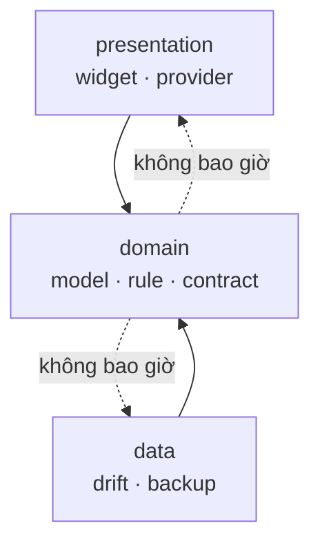
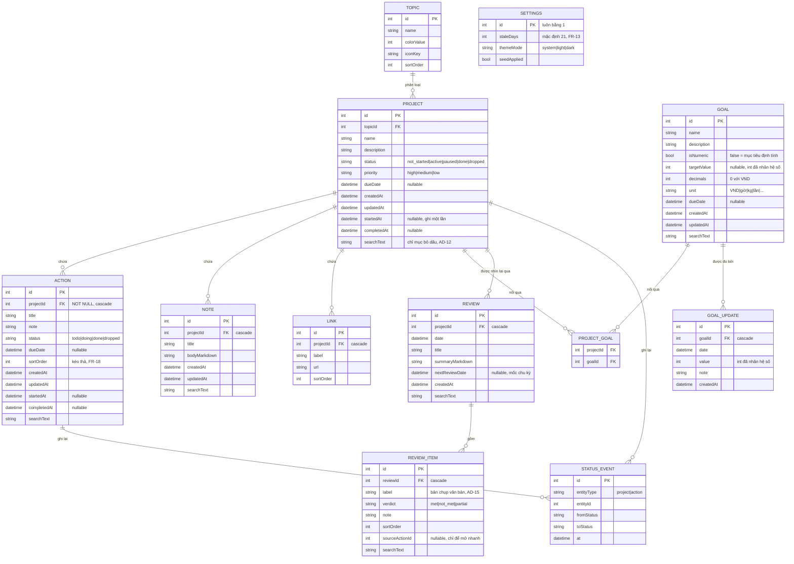
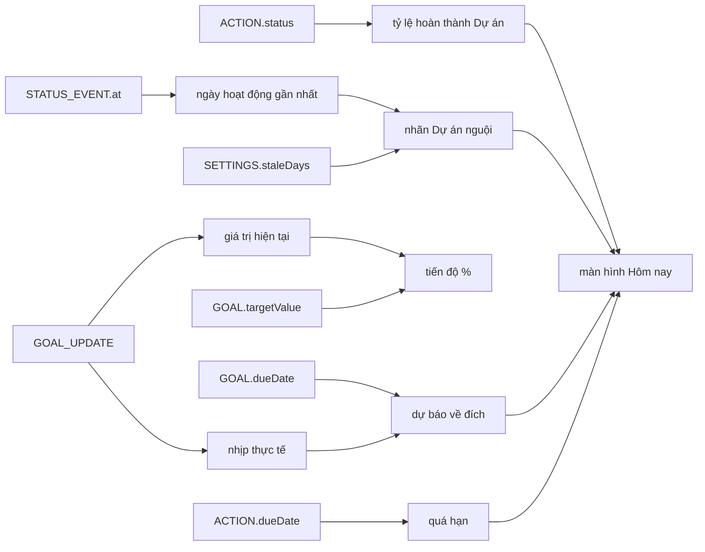

# Architecture Spine — App Quản lý Dự án & Mục tiêu Cá nhân

## Mô hình thiết kế

**Clean Architecture rút gọn, chia theo tính năng.** Ba tầng, bỏ các lớp trung gian không mang lại giá trị ở quy mô này: không có lớp `UseCase` riêng cho mỗi hành động, không tách `Entity` khỏi `Model` khi hai thứ trùng nhau.

| Tầng | Trách nhiệm | Được phép phụ thuộc vào |
|---|---|---|
| `presentation` | Widget, màn hình, provider của Riverpod | `domain` |
| `domain` | Model thuần Dart, quy tắc nghiệp vụ, hợp đồng repository | không phụ thuộc tầng nào |
| `data` | Cài đặt repository, bảng Drift, sao lưu JSON | `domain` |



Khác biệt so với dự án `personal_finance`: **không có tầng `data/remote/`**. Ứng dụng này không gọi mạng, nên nhánh đó không tồn tại chứ không phải bị bỏ trống.

## Bất biến và quy tắc

### AD-1 — Hướng phụ thuộc một chiều

- **Ràng buộc:** toàn bộ mã nguồn
- **Ngăn chặn:** logic nghiệp vụ dính vào Flutter hoặc Drift, khiến không viết test được nếu không dựng môi trường giả lập
- **Quy tắc:** file trong `domain/` không được `import` bất cứ thứ gì từ `package:flutter`, `package:drift`, hay từ `data/` và `presentation/`. Hai tầng kia phụ thuộc vào `domain` qua các lớp trừu tượng trong `domain/repositories/`.

### AD-2 — Riverpod 3.3.2, khai báo provider thủ công `[ĐÃ CHỐT]`

- **Ràng buộc:** toàn bộ tầng `presentation`
- **Ngăn chặn:** nửa codebase dùng codegen, nửa viết tay; và việc `riverpod_generator` phá vỡ tầng dữ liệu
- **Quy tắc:** dùng `flutter_riverpod: ^3.3.2`. Không thêm `riverpod_generator`, `riverpod_annotation`, `riverpod_lint`, `custom_lint`. Provider khai báo bằng tay dưới dạng biến `final` cấp cao nhất trong `presentation/providers/`.

**Lý do:** `riverpod_generator` cần `analyzer ^9/^12` trong khi `drift_dev` cần `^10/^13` — loại trừ nhau dưới Dart 3.10.9. Ràng buộc này đã được kiểm chứng bằng lỗi thật ở dự án `personal_finance`.

### AD-3 — Giá trị suy ra không bao giờ lưu cứng

- **Ràng buộc:** FR-12, FR-22, FR-24
- **Ngăn chặn:** con số hiển thị lệch khỏi dữ liệu nguồn sau khi người dùng sửa hoặc xoá một bản ghi quá khứ — kiểu lỗi không báo lỗi, chỉ lặng lẽ sai
- **Quy tắc:** cấm tuyệt đối các cột sau ở mọi bảng:

```
Project.completionRatio   Project.completionPercent   Project.actionCount
Goal.currentValue         Goal.progress               Goal.progressPercent
```

Hai công thức, luôn tính tại chỗ:

```
tỷ_lệ_hoàn_thành(dự án) = |hành động Xong| ÷ |hành động không Bỏ|
tiến_độ(mục tiêu, t)    = giá_trị_mốc_gần_nhất(≤ t) ÷ giá_trị_đích
```

Người dùng sửa và xoá được Mốc quá khứ, kể cả đổi ngày (FR-21) — mọi giá trị phía sau phải tự đúng theo. Đây là bản sao của quy tắc vốn góp lũy kế ở `personal_finance`, sinh ra từ cùng một loại lỗi.

**Ngoại lệ duy nhất và có chủ đích:** cột `searchText` ở AD-12 là *chỉ mục tìm kiếm*, không phải giá trị nghiệp vụ. Nó được sinh lại trong cùng giao dịch với mỗi lần ghi, và nếu sai thì hậu quả là "tìm không ra", không phải "hiện số sai".

### AD-4 — Không có số thực dấu phẩy động trong phép tính tiền tệ

- **Ràng buộc:** FR-20, FR-22, FR-24, FR-26
- **Ngăn chặn:** mục tiêu 1.000.000.000 ₫ hiển thị thành `1.000.000.064` — `double` chỉ giữ chính xác được số nguyên tới 2⁵³, nhưng sai số làm tròn xuất hiện sớm hơn nhiều qua các phép chia liên tiếp
- **Quy tắc:** ba tầng biểu diễn tách bạch:
  - **Lưu trữ:** giá trị tiền tệ là `int` đơn vị đồng. Giá trị mục tiêu đơn vị khác (giờ, kg, lần) là `int` đã nhân hệ số, kèm cột `decimals`.
  - **Tính toán:** chuyển sang `Decimal` (gói `decimal`) trước khi nhân chia.
  - **Hiển thị:** làm tròn **duy nhất một lần**, ở lớp định dạng.

Từ khoá `double` không được xuất hiện trong `lib/domain/` và không được là kiểu của bất kỳ cột Drift nào. Ngoại lệ duy nhất: toạ độ vẽ biểu đồ trong `lib/presentation/`.

### AD-5 — Dấu thời gian do hệ thống ghi

- **Ràng buộc:** FR-6, FR-8, FR-16
- **Ngăn chặn:** dữ liệu thời gian rỗng hoặc sai vì người dùng quên nhập — mà chính thiếu thời gian là khuyết tật lớn nhất của hai file PDF gốc
- **Quy tắc:** `createdAt`, `updatedAt`, `startedAt`, `completedAt` do repository ghi, **không có ô nhập nào trong giao diện**. Chỉ `dueDate` (hạn chót) và `GoalUpdate.date` là do người dùng chọn.
  - `startedAt` ghi **một lần duy nhất**, ở lần đầu chuyển sang `Đang làm`, và không bao giờ bị xoá sau đó.
  - `completedAt` ghi khi chuyển sang `Xong`, **bị xoá** khi rời khỏi `Xong`.

### AD-6 — Không có mạng, điểm

- **Ràng buộc:** FR-33, NFR-3
- **Ngăn chặn:** dữ liệu cá nhân — mục tiêu tài chính thật, tên người thật, kế hoạch gia đình — rời khỏi máy
- **Quy tắc:** không có `lib/data/remote/`. Không có `package:http` trong `pubspec.yaml`. Không `HttpClient`, không `WebSocket`, không thư viện phân tích hành vi, không quảng cáo, không thu thập số liệu sử dụng.

Ngoại lệ duy nhất: `url_launcher` mở URL của `Link` ra **trình duyệt của hệ điều hành** (FR-28). Bản thân ứng dụng không tải nội dung nào về.

### AD-7 — Không có tác vụ nền

- **Ràng buộc:** toàn bộ ứng dụng
- **Ngăn chặn:** trạng thái thay đổi ở nơi người dùng không nhìn thấy, và pin bị tiêu tốn cho việc không cần thiết
- **Quy tắc:** mọi tính toán chạy khi ứng dụng đang mở và đang được nhìn. Không `WorkManager`, không `BackgroundFetch`, không thông báo đẩy. Nhãn "nguội", "quá hạn", "chậm nhịp" được tính lúc dựng hình, so với `DateTime.now()`.

### AD-8 — Hành động luôn thuộc đúng một Dự án, không có cây con

- **Ràng buộc:** FR-14, FR-15
- **Ngăn chặn:** cây phân cấp nhiều tầng — thứ làm sập mọi công cụ quản lý việc cá nhân tự viết, vì chi phí sắp xếp vượt qua giá trị nhận được
- **Quy tắc:** `Action.projectId` là `NOT NULL` với khoá ngoại `ON DELETE CASCADE`. Không có `Action.parentId`. Một việc quá lớn thì nó là `Project`, không phải cây con.

### AD-9 — Trạng thái là tập đóng, lưu bằng chuỗi ổn định

- **Ràng buộc:** FR-8, FR-16
- **Ngăn chặn:** trạng thái trở lại thành chữ tự do — đúng khuyết tật của file PDF gốc; và việc chèn một trạng thái mới ở giữa làm lệch toàn bộ dữ liệu cũ nếu lưu bằng số thứ tự
- **Quy tắc:** lưu bằng **chuỗi định danh ổn định**, không lưu chỉ số enum:

```
ProjectStatus : not_started · active · paused · done · dropped
ActionStatus  :               todo · doing · done · dropped
Priority      : high · medium · low
```

Đọc lên gặp chuỗi lạ thì ánh xạ về giá trị mặc định (`todo` / `not_started` / `medium`) và **không được ném lỗi làm chết màn hình**. Nhãn tiếng Việt nằm ở lớp l10n, không nằm trong cơ sở dữ liệu.

### AD-15 — Đợt đánh giá là thực thể riêng, không tái dùng `Action`

- **Ràng buộc:** FR-35…FR-40
- **Ngăn chặn:** làm hỏng ngữ nghĩa trạng thái của `Action` bằng cách nhét một vòng đánh giá lặp lại vào một bản ghi vốn chỉ có một vòng đời `Chưa → Đang làm → Xong`
- **Quy tắc:** `Action` trả lời *"việc này làm xong chưa"* — vòng đời một chiều, kết thúc ở `Xong`. `Review` trả lời *"chu kỳ vừa rồi có tiến bộ không"* — cùng một nội dung được chấm lại ở nhiều mốc, kết quả là `met` / `not_met` / `partial`, và không có khái niệm "xong vĩnh viễn".

`ReviewItem.label` là **bản chụp văn bản tại thời điểm đánh giá**, không phải khoá ngoại tới `Action`. Sửa một Hành động về sau không được làm đổi nội dung một Đợt đánh giá quá khứ — nhật ký phải giữ đúng chữ đã viết lúc đó. `ReviewItem.sourceActionId` tồn tại nhưng chỉ để mở nhanh Hành động liên quan; nó `nullable` và không tham gia vào bất kỳ phép tính nào.

### AD-10 — Mọi thay đổi cấu trúc dữ liệu phải có đường chuyển đổi

- **Ràng buộc:** NFR-4
- **Ngăn chặn:** mất dữ liệu người dùng khi cập nhật ứng dụng, không có đường khôi phục
- **Quy tắc:** mỗi lần tăng `schemaVersion`, làm đủ bốn bước:

```bash
fvm dart run drift_dev schema dump lib/data/db/database.dart drift_schemas/
fvm dart run drift_dev schema generate drift_schemas/ test/data/db/generated/
```
3. Thêm bước nâng cấp vào `MigrationStrategy.onUpgrade`
4. Thêm test `migrateAndValidate` cho cặp phiên bản mới

Cấm xoá cột đang chứa dữ liệu người dùng mà không có bước chuyển sang nơi khác.

### AD-11 — Sao lưu là hợp đồng có phiên bản, nhập là thao tác nguyên tử

- **Ràng buộc:** FR-31, FR-32
- **Ngăn chặn:** người dùng mất sạch dữ liệu vì nhập nhầm một file hỏng — đây là thao tác duy nhất trong ứng dụng có thể xoá mọi thứ
- **Quy tắc:**
  - File JSON mở đầu bằng `{"schemaVersion": <int>, "exportedAt": "<ISO8601>"}`.
  - Nhập chạy trong **một giao dịch duy nhất**: kiểm tra toàn bộ file trước, ghi sau. Sai bất kỳ chỗ nào thì cuộn ngược hoàn toàn, dữ liệu hiện tại không đụng tới.
  - `schemaVersion` của file lớn hơn của ứng dụng → từ chối kèm thông báo cần cập nhật ứng dụng.
  - `schemaVersion` nhỏ hơn → chạy qua đúng chuỗi hàm nâng cấp của bộ nhập, không dùng lại `onUpgrade` của Drift.
  - Nhập là **thay thế toàn bộ**, không trộn (PRD §7.6).

### AD-12 — Tìm kiếm bỏ dấu qua cột chuẩn hoá

- **Ràng buộc:** FR-30
- **Ngăn chặn:** gõ `tai chinh` không tìm ra `Kế hoạch tài chính` — SQLite không có hàm bỏ dấu, `LIKE` mặc định cũng không xử lý được tiếng Việt
- **Quy tắc:** mỗi bảng tìm kiếm được mang thêm cột `searchText`: nội dung đã hạ chữ thường, bỏ dấu, gộp khoảng trắng. Cột này do repository sinh **trong cùng giao dịch** với mỗi lần ghi, không bao giờ do giao diện gán. Hàm bỏ dấu nằm ở `domain/rules/` và có test riêng cho đủ bộ dấu tiếng Việt kể cả `đ/Đ`.

### AD-13 — Cây phụ thuộc không được chứa build hooks `[ĐÃ CHỐT]`

- **Ràng buộc:** `pubspec.yaml`
- **Ngăn chặn:** mất khả năng sinh mã Drift, tức là mất toàn bộ tầng dữ liệu
- **Quy tắc:** `build_runner` biên dịch builder bằng `dart compile`, mà `dart compile` chưa hỗ trợ build hooks. Một gói dùng hooks lọt vào cây phụ thuộc là hỏng ngay, lỗi hiện ra dạng:

```
'dart compile' does not support build hooks, use 'dart build' instead.
```

Hai ràng buộc đang giữ điều đó, mang nguyên từ `personal_finance`:
- `drift_flutter` phải ở nhánh **0.2.x** — nhánh 0.3.x kéo `sqlite3` 3.x vốn dùng hooks
- `path_provider_foundation` ghim đè **2.5.1** — bản 2.6.0 kéo `objective_c` vốn dùng hooks

Trước khi thêm bất kỳ gói mới nào:

```bash
ls ~/.pub-cache/hosted/pub.dev/<tên>-<phiên bản>/hook 2>/dev/null
```

### AD-16 — iOS deployment target tối thiểu 14.0 `[ĐÃ CHỐT]`

- **Ràng buộc:** `ios/Podfile`, `ios/Runner.xcodeproj/project.pbxproj`
- **Ngăn chặn:** `pod install` thất bại với thông báo *"The plugin
  file_picker_darwin requires a higher minimum iOS deployment version"* — bản
  dựng iOS hỏng hoàn toàn, không phải hỏng một tính năng
- **Quy tắc:** `platform :ios, '14.0'` trong Podfile và
  `IPHONEOS_DEPLOYMENT_TARGET = 14.0` ở cả ba cấu hình trong pbxproj. Ba chỗ
  phải khớp nhau.

Template của Flutter 3.38.10 sinh ra 13.0. Nâng lên vì `file_picker_darwin
1.0.3` đặt `s.ios.deployment_target = '14.0'`. Phát hiện bằng bản dựng thật,
không phải bằng phân tích tĩnh — đây là lý do phải chạy `flutter build ios`
trước khi giao cho người dùng thử.

### AD-14 — Bộ công cụ Android bám theo template của SDK `[ĐÃ CHỐT]`

- **Ràng buộc:** `android/`
- **Ngăn chặn:** không biên dịch được các plugin đời mới vì Kotlin quá cũ
- **Quy tắc:** AGP **8.11.1** · Kotlin **2.2.20** · Gradle **8.14**, khớp phiên bản Flutter SDK dùng trong template. Khi nâng SDK, đối chiếu lại ba con số này trong `.fvm/flutter_sdk/packages/flutter_tools/lib/src/android/gradle_utils.dart`.

## Quy ước nhất quán

| Hạng mục | Quy ước |
|---|---|
| Tên bảng Drift | Số nhiều, `PascalCase`: `Projects`, `Actions`, `Goals` |
| Tên biến tiền tệ | Kết thúc bằng `Amount`, luôn là `int` đơn vị đồng |
| Tên biến số lượng | Kết thúc bằng `Value`, luôn đi kèm `decimals` |
| Tên provider | `camelCase` kết thúc bằng `Provider` |
| Tên trạng thái trong DB | `snake_case`, xem AD-9 |
| Lỗi | Kiểu kết quả tường minh ở ranh giới tầng `data`; không `throw` để truyền lỗi nghiệp vụ |
| Chuỗi hiển thị | Qua lớp l10n, không viết thẳng tiếng Việt trong widget |
| Ngày trong DB | Lưu UTC dạng `DateTime`; chỉ đổi sang giờ địa phương ở lớp định dạng |
| Ngày không có giờ | `dueDate` và `GoalUpdate.date` lưu ở mốc 00:00 giờ địa phương quy về UTC |

## Ngăn xếp công nghệ

| Thành phần | Phiên bản | Ghi chú |
|---|---|---|
| Flutter SDK | 3.38.10 / Dart 3.10.9 | Ghim qua FVM (`.fvmrc`). Máy còn bản 3.29.2 dùng chung cho các dự án eGOV — chạy `flutter` trần sẽ giải phụ thuộc thất bại |
| `flutter_riverpod` | ^3.3.2 | Không codegen — AD-2 |
| `drift` | ^2.31.0 | |
| `drift_flutter` | ^0.2.8 | Khoá ở 0.2.x — AD-13 |
| `decimal` | ^3.2.6 | Bắt buộc — AD-4 |
| `intl` | 0.20.2 | Bị ghim bởi `flutter_localizations` trong SDK |
| `fl_chart` | ^1.2.0 | Biểu đồ đường tiến độ Mục tiêu — FR-23 |
| `shared_preferences` | ^2.5.5 | Cài đặt nhẹ: bộ lọc đã nhớ, đã nạp hạt giống chưa |
| `path_provider` | ^2.1.6 | Ghim đè `path_provider_foundation: 2.5.1` — AD-13 |
| `share_plus` | ^13.3.0 | Xuất sao lưu — FR-31 |
| `url_launcher` | ^6.3.1 | Mở Liên kết ngoài — FR-28. **Cần kiểm tra `hook/` trước khi thêm** |
| `flutter_markdown` hoặc tương đương | cần khảo sát | Dựng hình Ghi chú — FR-27. **Cần kiểm tra `hook/`**; phương án dự phòng là tự dựng hình tập markdown tối thiểu |
| Nhập file sao lưu | cần khảo sát | `file_picker` chưa được kiểm chứng về build hooks. Phương án dự phòng đã đủ dùng: dán nội dung JSON vào ô văn bản |

**Không có `http`.** Xem AD-6.

## Bộ khung cấu trúc

### Sơ đồ thực thể



**Ba điều cần chú ý trong sơ đồ:**

`GOAL` không có cột `currentValue` — giá trị hiện tại là `GOAL_UPDATE` có `date` lớn nhất. `PROJECT` không có cột đếm hay tỷ lệ — chúng tính từ `ACTION`. Cả hai theo AD-3.

`PROJECT_GOAL` là bảng nối nhiều-nhiều, khoá chính ghép `(projectId, goalId)` — theo FR-25.

`REVIEW` không có cột `metCount` hay `metRatio` — tỷ lệ đạt tính từ `REVIEW_ITEM` theo AD-3.

`STATUS_EVENT` là bảng chỉ ghi thêm, không sửa. Nó phục vụ FR-8 (*xem lại lịch sử đổi trạng thái*) và là nguồn duy nhất để tính "ngày hoạt động gần nhất" của Dự án ở FR-13.

### Luồng tính toán



Không ô nào trong sơ đồ này được lưu vào cơ sở dữ liệu ngoài bốn ô nguồn ở bên trái.

### Cây thư mục

```
lib/
  core/
    format/          định dạng ngày, số, tiền kiểu Việt Nam
    l10n/            chuỗi hiển thị
    result/          kiểu kết quả tường minh
  domain/
    models/          Project · Action · Goal · GoalUpdate · Topic · Note · Link
    rules/           completion · progress · pace · stale · slugify (bỏ dấu)
    repositories/    chỉ hợp đồng trừu tượng
  data/
    db/              database.dart · tables · daos
    backup/          mã hoá và giải mã JSON sao lưu
    seed/            dữ liệu hạt giống từ hai file PDF
    repositories/    cài đặt hợp đồng của domain
  features/
    today/           màn hình Hôm nay
    projects/        danh sách và chi tiết Dự án
    actions/         thêm, sửa, kéo thả Hành động
    goals/           danh sách, chi tiết, biểu đồ, sổ Mốc
    notes/           Ghi chú markdown
    reviews/         Đợt đánh giá định kỳ
    search/          tìm kiếm toàn cục
    settings/        cài đặt, sao lưu, khôi phục
    onboarding/      lần chạy đầu và nạp hạt giống
  presentation/
    providers/       provider Riverpod khai báo tay
    widgets/         widget dùng chung
  app.dart
  main.dart
```

## Bản đồ tính năng sang kiến trúc

| Nhóm FR | Thành phần chịu trách nhiệm | AD ràng buộc |
|---|---|---|
| FR-1…FR-4 khởi tạo và hạt giống | `data/seed/`, `features/onboarding/` | AD-11 |
| FR-5…FR-13 Dự án | `domain/models/project.dart`, `domain/rules/completion.dart`, `features/projects/` | AD-3, AD-5, AD-9 |
| FR-14…FR-19 Hành động | `domain/models/action.dart`, `features/actions/` | AD-5, AD-8, AD-9 |
| FR-20…FR-26 Mục tiêu | `domain/rules/progress.dart`, `domain/rules/pace.dart`, `features/goals/` | AD-3, AD-4 |
| FR-27…FR-28 Ghi chú, Liên kết | `features/notes/`, `presentation/widgets/link_tile.dart` | AD-6 |
| FR-29 Hôm nay | `features/today/`, tổng hợp từ nhiều rule | AD-3, AD-7 |
| FR-30 Tìm kiếm | `domain/rules/slugify.dart`, `data/db/daos/search_dao.dart` | AD-12 |
| FR-35…FR-40 Đợt đánh giá | `domain/models/review.dart`, `domain/rules/review.dart`, `features/reviews/` | AD-3, AD-15 |
| FR-31…FR-32 Sao lưu | `data/backup/` | AD-11 |
| FR-33…FR-34 Offline, cài đặt | toàn bộ `pubspec.yaml`, `core/l10n/` | AD-6, AD-10 |

## Sai lệch có chủ đích so với PRD

Ba điểm dưới đây khác PRD, đều có lý do kỹ thuật cụ thể và đã được ghi lại để
không bị hiểu là trôi dạt.

**1. Tên lớp Dart của `Action` là `ProjectAction`.**
`Action` đã là một lớp của `package:flutter/widgets.dart`; đặt trùng buộc mọi
widget phải dùng tiền tố import. Thuật ngữ nghiệp vụ, nhãn giao diện và tên
bảng cơ sở dữ liệu vẫn là `Action` / `actions` — chỉ tên lớp Dart đổi.

**2. Lớp l10n là hằng số Dart, không phải bộ sinh mã ARB.**
Ứng dụng chỉ có một ngôn ngữ. Toàn bộ chuỗi hiển thị nằm ở `core/l10n/strings.dart`
dưới dạng `abstract final class S`, đúng tinh thần "một nơi duy nhất chứa chuỗi
hiển thị" của FR-34. Thêm ngôn ngữ thứ hai chỉ cần đổi các hằng số thành tra cứu
theo locale; chỗ gọi không đổi. `flutter_localizations` vẫn được giữ vì định dạng
ngày và số cần dữ liệu locale `vi_VN`.

**3. Markdown do ứng dụng tự dựng hình.**
`presentation`-level `MarkdownView` xử lý tiêu đề, danh sách, đậm và nghiêng —
đủ cho toàn bộ nội dung Ghi chú thật ở `addendum.md` §1.4. Tránh được một gói
phụ thuộc phải qua vòng kiểm tra build hooks của AD-13.

## Hoãn lại

Những quyết định dưới đây **cố ý chưa chốt**, vì chưa có đủ thông tin và việc chốt sớm không mang lại lợi ích:

- **Cách nhập file sao lưu.** `file_picker` chưa kiểm chứng. Phương án dán JSON vào ô văn bản đủ dùng và không thêm phụ thuộc nào.
- **Ngưỡng "chậm nhịp" của Mục tiêu ở FR-24.** Bao nhiêu phần trăm lệch thì gọi là chậm — chờ dữ liệu thật sau vài tháng dùng.
- **Có cần bảng `Idea` riêng khi làm Ngân hàng ý tưởng** hay tái dùng `Note` với `projectId` cho phép rỗng. Quyết khi bắt đầu hạng mục roadmap đó, không quyết trước.
