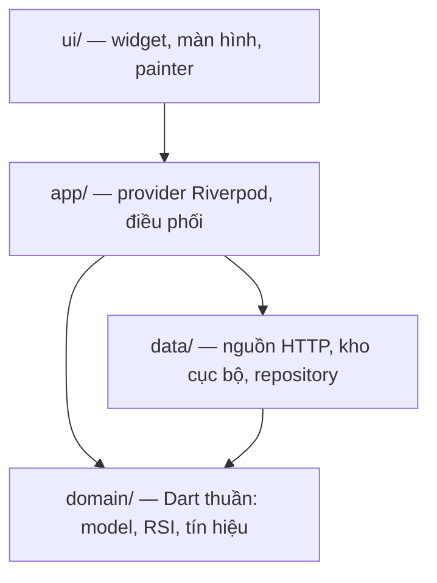
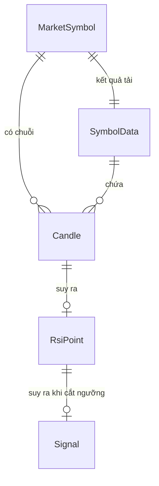
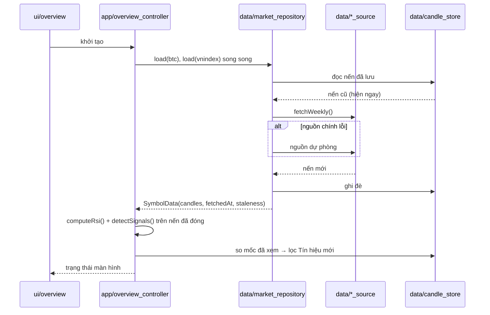

# Architecture Spine — RSI Alert

## Design Paradigm

Phân tầng, phụ thuộc **chỉ hướng vào trong**. Bốn tầng ánh xạ thẳng sang thư mục dưới `lib/`:



`domain/` không biết gì về ba tầng còn lại. `ui/` không bao giờ chạm `data/`.

## Invariants & Rules

### AD-1 — `domain/` là Dart thuần

- **Binds:** all
- **Prevents:** logic nghiệp vụ bị dính vào Flutter hoặc vào hình dạng JSON của một nhà cung cấp, khiến không test được và không đổi nguồn được.
- **Rule:** không file nào dưới `lib/domain/` được `import` `package:flutter/*`, `package:http/*`, `package:shared_preferences/*`, hay bất kỳ package nào không phải `dart:` lõi. Vi phạm bị bắt bởi test `test/architecture_test.dart`.

### AD-2 — RSI và Tín hiệu luôn được suy ra, không bao giờ lưu

- **Binds:** FR-4, FR-9, FR-12, FR-13
- **Prevents:** giá trị lưu cứng lệch khỏi chuỗi nến sau khi nguồn đính chính dữ liệu quá khứ — hỏng **không báo lỗi**, chỉ lặng lẽ cho ra số sai.
- **Rule:** Kho cục bộ chỉ được lưu OHLCV, mốc đã xem, và dấu thời gian cập nhật. Cấm tuyệt đối các trường sau ở mọi nơi lưu trữ: `rsi`, `rsiValue`, `status`, `signals`, `lastRsi`. RSI và Tín hiệu tính lại từ chuỗi nến mỗi lần cần dùng.

### AD-3 — Mốc thời gian nến giữ nguyên từ nguồn

- **Binds:** FR-6, FR-7, FR-10, FR-11
- **Prevents:** hai Mã bị ép về chung một mốc tuần, làm nến BTC (tuần UTC từ thứ Hai) lệch khỏi nến VNINDEX (tuần giao dịch Việt Nam) và sinh tín hiệu sai tuần.
- **Rule:** `Candle.openTime` là `DateTime` UTC lấy đúng từ nguồn, không làm tròn, không đổi múi giờ khi lưu. Chỉ tầng `ui/` mới đổi sang `Asia/Ho_Chi_Minh` để hiển thị. Chỉ nguồn dự phòng VNDirect được phép gộp nến ngày thành tuần, và việc gộp nằm trong adapter của chính nó.

### AD-4 — Adapter quyết định nến đã đóng hay chưa

- **Binds:** FR-4, FR-6, FR-10, FR-11
- **Prevents:** `domain/` phải đoán lịch giao dịch của từng thị trường — thứ nó không có đủ thông tin để biết.
- **Rule:** mỗi adapter đặt `Candle.isClosed` khi dựng nến, dựa trên dữ liệu nguồn trả về (Binance có `closeTime`; nguồn UDF suy từ `openTime + 7 ngày`) so với thời điểm hiện tại. `domain/` chỉ đọc cờ này, không tự tính lại từ đồng hồ hệ thống.

### AD-5 — Tín hiệu chỉ sinh từ nến đã đóng

- **Binds:** FR-4, FR-5, FR-9
- **Prevents:** cảnh báo giả từ nến tuần đang chạy, rồi tự rút lại khi tuần kết thúc — thứ phá hỏng lòng tin vào toàn bộ app.
- **Rule:** `detectSignals()` nhận vào chuỗi đã lọc `isClosed == true`. RSI tạm tính của nến đang chạy chỉ được dùng cho hiển thị, và mọi chỗ hiển thị nó phải kèm cờ `isProvisional`.

### AD-6 — Lỗi mạng không vượt qua biên repository

- **Binds:** FR-2, FR-3, FR-12, NFR độ tin cậy
- **Prevents:** mỗi widget tự bắt exception theo một kiểu khác nhau, và một nguồn chết làm trắng màn hình.
- **Rule:** `MarketRepository` không bao giờ ném ra ngoài. Nó trả `SymbolData` gồm `candles`, `fetchedAt`, và `staleness` ∈ {`fresh`, `stale`, `empty`} kèm `errorKind` tuỳ chọn. Adapter được phép ném; repository bắt, thử nguồn dự phòng, rồi rơi về Kho cục bộ.

### AD-7 — Biểu đồ tự vẽ, hai khung chung một viewport

- **Binds:** FR-6, FR-7, FR-8
- **Prevents:** hai khung cuộn lệch trục thời gian, và phụ thuộc vào một package biểu đồ không kiểm soát được.
- **Rule:** không thêm package biểu đồ nào. Khung giá và khung RSI là hai `CustomPainter` cùng đọc một đối tượng `ChartViewport` bất biến (`startIndex`, `visibleCount`) do màn hình Chi tiết sở hữu. Cử chỉ cuộn/phóng ở bất kỳ khung nào cũng chỉ cập nhật `ChartViewport` đó.

### AD-8 — Riverpod, không codegen

- **Binds:** all
- **Prevents:** xung đột phiên bản `analyzer` giữa các bộ sinh mã — chính lỗi đã gặp ở project `personal_projects` bên cạnh.
- **Rule:** khai báo provider thủ công (`NotifierProvider`, `Provider`, `FutureProvider`). Không `riverpod_generator`, không `build_runner`, không `freezed`. Model viết tay với `copyWith` và `==` tự cài.

### AD-9 — Kho cục bộ là JSON phẳng, một khoá mỗi Mã

- **Binds:** FR-3, FR-12
- **Prevents:** kéo cả sqlite vào cho ~1000 bản ghi, và ghép chồng từng phần làm chuỗi nến thủng lỗ.
- **Rule:** `shared_preferences`, khoá `candles.<symbol>` chứa `{"v":1,"fetchedAt":<epoch>,"candles":[...]}`, khoá `lastSeenSignal.<symbol>` chứa epoch của tuần tín hiệu cuối đã xem. Ghi là **thay toàn bộ**, không merge. Trường `v` sai thì bỏ dữ liệu và coi như `empty`, không cố nâng cấp.

### AD-10 — Chuỗi ký tự giao diện tập trung một chỗ

- **Binds:** all
- **Prevents:** tiếng Việt rải rác trong widget, và mỗi màn hình gọi một cách khác nhau cho cùng một khái niệm ở §3 Từ điển của PRD.
- **Rule:** mọi chuỗi **người dùng nhìn thấy** nằm trong `lib/ui/strings.dart`, với một ngoại lệ có tên: nhãn hiển thị của Mã (`label`, `fullName`) sống trong `lib/domain/market_symbol.dart` vì chúng là thuộc tính của chính Mã. Từ vựng phải khớp Từ điển PRD: *Quá bán*, *Quá mua*, *Trung tính*, *tạm tính*, *Tín hiệu*, *Nến tuần*. Không dùng từ đồng nghĩa. Thông điệp chẩn đoán (`MarketDataException`, `debugPrint`, `assert`) **không** thuộc phạm vi quy tắc này — chúng không bao giờ tới mắt người dùng; giao diện chỉ hiển thị lỗi qua `S.errorNote(kind)`.

### AD-11 — Ngưỡng và chu kỳ là hằng số một nguồn

- **Binds:** FR-4, FR-7, FR-13
- **Prevents:** số 14, 30, 70 nằm rải rác rồi lệch nhau giữa nơi tính và nơi vẽ vạch.
- **Rule:** khai báo một lần trong `lib/domain/constants.dart` (`rsiPeriod = 14`, `oversold = 30`, `overbought = 70`). Cấm literal 14/30/70 ở mọi nơi khác trong ngữ cảnh RSI.

### AD-12 — Vùng DCA là suy diễn thuần, ngưỡng theo từng Mã

- **Binds:** FR-14, FR-16, FR-17, FR-18
- **Prevents:** Vùng bị lưu cứng rồi lệch khỏi chuỗi nến; ngưỡng BTC bị áp nhầm cho VNINDEX.
- **Rule:** `classifyDcaWeeks()` và `computeZoneStats()` trong `lib/domain/dca.dart` là hàm thuần, chỉ nhận Nến đã đóng (AD-5). Ngưỡng là `btcDcaThresholds` / `vnindexDcaThresholds` trong `constants.dart` (AD-11), chọn qua `dcaThresholdsOf(symbol)`. Kho chỉ lưu `lastSeenDca.<symbol>` (epoch tuần), không lưu Vùng, không lưu cờ phân kỳ. Câu hành động hiển thị cho mỗi Vùng nằm trong `S.dcaRule()` và luôn đi với `S.dcaQuotePrefix`.

### AD-13 — F&G là nguồn thứ tư, chỉ cho BTC, chỉ để tăng cường

- **Binds:** FR-15
- **Prevents:** một API không chính thức thứ tư chặn được việc xếp Vùng; cổng "F&G < 20" bỏ lỡ đáy thật.
- **Rule:** `FearGreedSource` (`api.alternative.me/fng/`) là host ra ngoài thứ tư và cuối cùng. Repository tải nó song song với hai Mã, không bao giờ ném. Hỏng thì dùng bản đã lưu ở khoá `fearGreed` (cùng lược đồ `v`, thay toàn bộ); không có thì danh sách rỗng. F&G chỉ gắn `fearGreedConfirms`, không bao giờ đổi `zone`.

### AD-14 — Lời nhắc tuần: port ở domain, thông báo cục bộ ở data

- **Binds:** FR-19
- **Prevents:** `ui/` import `data/`; test phụ thuộc plugin native; lời nhắc nói Vùng của nến chưa đóng.
- **Rule:** interface `WeeklyReminder` và `ReminderText` (Dart thuần) nằm ở `lib/domain/weekly_reminder.dart`. Bản cài `LocalNotificationWeeklyReminder` (`flutter_local_notifications` + `timezone`) nằm ở `lib/data/`. `weeklyReminderProvider` mặc định là `NoopWeeklyReminder`; `RsiMiniApp.createContainer` ghi đè bằng bản thật. `HomeShell` gọi `ensureScheduled` mỗi lần mở, truyền chữ từ `S`. Nội dung không chứa Vùng hay RSI. Host native cần desugaring và receiver trên Android, `UNUserNotificationCenter` delegate trên iOS.

## Consistency Conventions

| Concern | Convention |
| --- | --- |
| Đặt tên | Model danh từ số ít tiếng Anh (`Candle`, `RsiPoint`, `Signal`, `SymbolData`). File `snake_case.dart`. Provider hậu tố `Provider`. Painter hậu tố `Painter`. |
| Mã Mã | `enum MarketSymbol { btc, vnindex }`. Chuỗi thô `"BTC"` / `"VNINDEX"` chỉ xuất hiện trong adapter và trong khoá lưu trữ. |
| Ngày giờ | `DateTime` UTC ở mọi tầng trừ `ui/`. Nguồn trả epoch giây → `DateTime.fromMillisecondsSinceEpoch(t*1000, isUtc: true)`. Hiển thị qua `intl` với `Asia/Ho_Chi_Minh`. |
| Số | `double` cho giá và RSI. Không có phép tính tiền tệ nào trong app này, nên không cần `Decimal`. RSI làm tròn **chỉ khi hiển thị**, không làm tròn khi tính. |
| Lỗi | `domain/` và `data/adapter` ném `MarketDataException(kind, message)` với `kind ∈ {network, http, parse, empty}`. Repository là nơi duy nhất bắt. `app/` và `ui/` không dùng `try/catch` cho luồng dữ liệu. |
| Trạng thái | Mọi thay đổi trạng thái đi qua provider Riverpod. Widget không giữ trạng thái nghiệp vụ; `ChartViewport` là ngoại lệ có chủ đích, sống trong `State` của màn hình Chi tiết. |
| Log | `debugPrint` chỉ trong `data/`. Không gửi bất kỳ log nào ra ngoài máy. |
| Test | `test/domain/` cho hàm thuần (bắt buộc, không mock). `test/data/` dùng `MockClient` của `package:http/testing.dart` — không thêm package mock nào (NFR-6). Bộ dữ liệu cố định đặt tại `test/fixtures/`. |

## Stack

| Name | Version |
| --- | --- |
| Flutter | 3.38.10 (ghim qua FVM, `.fvmrc`) |
| Dart | 3.10.9 |
| flutter_riverpod | ^3.3.2 (3.4.x yêu cầu Dart ≥3.12, SDK ghim là 3.10.9) |
| http | ^1.6.0 |
| flutter_local_notifications | ^22.3.3 (FR-19) |
| timezone | ^0.11.2 (FR-19) |
| shared_preferences | ^2.5.5 |
| intl | ^0.20.3 |
| flutter_lints | ^6.0.0 (dev) |


Không có package biểu đồ (AD-7). Không `flutter_localizations` — app chỉ tiếng Việt, và nó sẽ ghim `intl` xuống bản cũ.

## Structural Seed

```text
lib/
  main.dart                  # ProviderScope + MaterialApp
  domain/
    constants.dart           # rsiPeriod, oversold, overbought — AD-11
    market_symbol.dart       # enum MarketSymbol + siêu dữ liệu hiển thị
    candle.dart              # Candle: openTime UTC, ohlcv, isClosed — AD-3, AD-4
    rsi.dart                 # computeRsi(): hàm thuần Wilder — FR-13
    signal.dart              # Signal + detectSignals() — FR-4, AD-5
    dca.dart                 # DcaZone, classifyDcaWeeks, phân kỳ, ZoneStats — AD-12
    fear_greed.dart          # FearGreedPoint, tra F&G theo tuần — AD-13
    weekly_reminder.dart     # port WeeklyReminder + ReminderText — AD-14
    rsi_status.dart          # RsiStatus + suy ra từ giá trị RSI — AD-2
  data/
    market_data_source.dart  # interface + MarketDataException
    binance_source.dart      # FR-10, data-api.binance.vision
    ssi_source.dart          # FR-11 nguồn chính
    vndirect_source.dart     # FR-11 dự phòng, gộp nến ngày → tuần
    candle_store.dart        # FR-12, shared_preferences — AD-9
    market_repository.dart   # điều phối nguồn + kho, trả SymbolData — AD-6
    fear_greed_source.dart   # FR-15, api.alternative.me — AD-13
    weekly_reminder.dart     # FR-19, flutter_local_notifications — AD-14
  app/
    providers.dart           # provider Riverpod — AD-8
    overview_controller.dart # tải hai Mã song song, tính tín hiệu mới — FR-2, FR-5
  ui/
    strings.dart             # AD-10
    theme.dart
    overview/                # FR-1, FR-3, FR-5
    detail/                  # FR-6, FR-7, FR-8 + ChartViewport, painter — AD-7
    history/                 # FR-9
    widgets/
test/
  architecture_test.dart     # canh gác AD-1
  domain/  data/  fixtures/
```

Thực thể lõi:



`RsiPoint` và `Signal` không có nơi lưu trữ — chúng chỉ tồn tại trong bộ nhớ, sinh ra từ `Candle` (AD-2).

Luồng một lần mở app:



## Capability → Architecture Map

| FR | Lives in | Governed by |
| --- | --- | --- |
| FR-1, FR-3 | `ui/overview/`, `app/overview_controller.dart` | AD-2, AD-6, AD-10 |
| FR-2 | `app/overview_controller.dart`, `data/market_repository.dart` | AD-6 |
| FR-4, FR-5 | `domain/signal.dart`, `app/overview_controller.dart` | AD-2, AD-5, AD-11 |
| FR-6, FR-7, FR-8 | `ui/detail/` | AD-3, AD-7, AD-11 |
| FR-9 | `ui/history/`, `domain/signal.dart` | AD-2, AD-5 |
| FR-10 | `data/binance_source.dart` | AD-3, AD-4 |
| FR-11 | `data/ssi_source.dart`, `data/vndirect_source.dart` | AD-3, AD-4, AD-6 |
| FR-12 | `data/candle_store.dart` | AD-2, AD-9 |
| FR-13 | `domain/rsi.dart` | AD-1, AD-11 |
| FR-14, FR-16, FR-18 | `domain/dca.dart`, `app/symbol_view.dart`, `ui/overview/dca_section.dart`, `ui/overview/dca_guide_sheet.dart` | AD-2, AD-5, AD-11, AD-12 |
| FR-15 | `domain/fear_greed.dart`, `data/fear_greed_source.dart`, `data/market_repository.dart` | AD-6, AD-13 |
| FR-17 | `app/overview_controller.dart`, `ui/overview/dca_banner.dart` | AD-12 |
| FR-19 | `domain/weekly_reminder.dart`, `data/weekly_reminder.dart`, `ui/home_shell.dart` | AD-14 |

## Deferred

- **Chạy nền để lời nhắc mang nội dung Vùng** — FR-19 chỉ nhắc chung chung. Muốn nhắc kèm Vùng thì phải thêm chạy nền (workmanager, iOS BGAppRefresh — không bảo đảm giờ chạy) hoặc backend. AD-6, AD-9 và AD-14 đủ ổn định để chịu được việc đó về sau.
- **Chạm thông báo mở thẳng mini app** — hiện chạm vào sẽ mở super app ở launcher. Muốn mở thẳng thì cần một kênh deep link trong `mini_app_core`.
- **Ngưỡng tự đặt và thêm Mã** — AD-11 cố tình khoá cứng hằng số. Khi mở ra, đổi `constants.dart` thành một đối tượng cấu hình đọc từ kho; các tầng khác không đổi.
- **Chiến lược khi hai nguồn VNINDEX lệch số** — Open Question 3 của PRD. v1 tin nguồn chính, không đối chiếu.
- **Nến VNINDEX đang chạy vào cuối tuần** — Open Question 4. v1 theo đúng AD-4, không xử lý riêng.
- **Chế độ sáng/tối tuỳ chọn, đa ngôn ngữ** — ngoài phạm vi MVP; AD-10 giữ chuỗi ở một chỗ nên chi phí mở về sau thấp.
